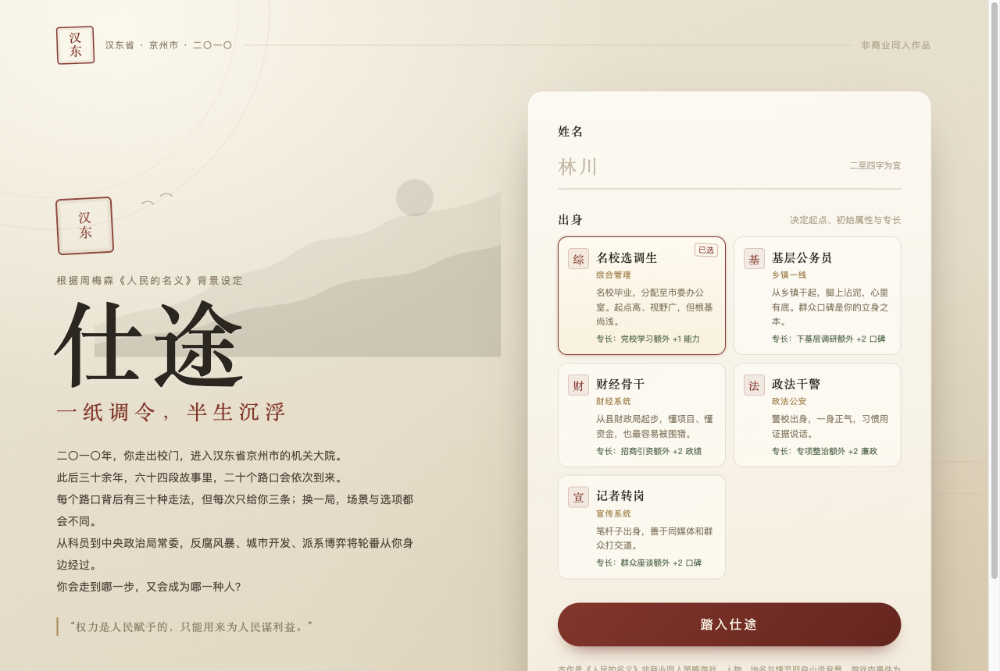

<div align="center">

# 汉东仕途

**一纸调令，半生沉浮**

一款基于周梅森《人民的名义》背景设定的单文件官场策略游戏  
A single-file Chinese officialdom strategy game inspired by *In the Name of the People*

[中文](#中文) · [English](#english)

</div>

---



## 中文

### 简介

2010 年，24 岁的你走出校门，进入汉东省京州市的机关大院。

此后三十余年，你要在 20 个十字路口上做出选择：是守正、实干、逢迎、权谋、走群众路线，还是抽身自保？每一次选择都会改变你的政绩、口碑、廉政、人脉、能力、健康与亲情，也会决定你最终能走多远。

从科员起步，你可以一路升到中央政治局委员，甚至进入中央政治局常委会，问鼎权力中枢；也可能在某一年的风暴里落马、成为弃子，或者平安着陆，把余生还给自己。

游戏没有后端、没有依赖、没有安装步骤。双击 `汉东仕途.html`，即可在浏览器中开始一局。

### 玩法特色

- **一条仕途，十一个台阶**：科员 → 副科 → 正科 → 副处 → 正处 → 副厅 → 正厅 → 副省 → 正省 → 中央政治局委员 → 中央政治局常委。
- **20 个路口，64 段故事**：场景池共 64 个，分属起步、县域、厅局、封疆四个时代；一局从每个时代抽 5 个，共 20 个场景。年份与顺序每局重新洗牌。
- **30 种走法，每次只给三条**：每个场景有 6 种立场 × 5 种手段，共 30 种结果；实际只随机展示 3 条不同立场的选项。换一局，场景和选项都会变。
- **七个维度**：政绩、口碑、廉政、人脉、能力、健康、亲情。任何一项失衡，都可能改变结局。
- **派系与忠心**：沙瑞金、李达康、高育良三条线，站队能换来庇护，但忠心也有代价。风险越高，越依赖靠山；靠山倒了，风险会回到自己身上。
- **年度考核与破格提拔**：每年评定优秀、称职、基本称职、不称职；连续六年优秀可以打破任职年限，提前晋升。
- **十三种结局**：从「人民的名义」「问鼎中枢」到「落马」「替罪羊」「孤独的晚年」，你的每一次妥协或坚持，都会在最后结算。
- **本地存档**：进度自动保存在浏览器 localStorage，刷新或下次打开可以继续。
- **响应式界面**：桌面端与移动端均可游玩，移动端提供底部导航。

### 快速开始

1. 下载或克隆本仓库。
2. 双击打开 `汉东仕途.html`（单文件发布版，推荐）。
3. 输入姓名，选择一种出身，点击「踏入仕途」。
4. 每年有 3 个行动点，可用于政务、社交与修身；用完后点击「结束本年」。
5. 十字路口出现时，从三条路中选一条。走到 60 岁退休，游戏结算结局。

开发时可打开 `index.html`；请保持 `css/` 与 `js/` 目录结构不变。

### 职级阶梯

| 级别 | 职级 | 代表职务 |
| --- | --- | --- |
| 0 | 科员级 | 科员 |
| 1 | 副科级 | 副科长 |
| 2 | 正科级 | 科长 |
| 3 | 副处级 | 副处长 |
| 4 | 正处级 | 处长 |
| 5 | 副厅级 | 副厅长 |
| 6 | 正厅级 | 厅长 |
| 7 | 副省级 | 副省长 |
| 8 | 正省级 | 省委书记 |
| 9 | 副国级 | 中央政治局委员 |
| 10 | 正国级 | 中央政治局常委 |

副国级及以上由中央组织部发布任命。越往上，廉政审查越严，风险容错越低。

### 场景与选项

一局 20 个场景，取自 64 个场景池：

| 时代 | 场景数 | 每局抽取 |
| --- | --- | --- |
| 起步（2010–2018） | 16 | 5 |
| 县域（2019–2027） | 16 | 5 |
| 厅局（2028–2036） | 16 | 5 |
| 封疆（2037–2046） | 16 | 5 |

每个场景内部有 6 种立场（守正、实干、逢迎、权谋、群众、抽身）与 5 种手段（亲自、借力、请示、公开、压后），组合出 30 种结果。界面每次只展示 3 条不同立场的选项，并给出属性变化与风险提示。

场景轮换会优先避开最近几局看过的内容，并排除上一局刚用过的场景，尽量让连续多局不重复。

### 结局

| 结局 | 基调 | 一句话 |
| --- | --- | --- |
| 人民的名义 | 最佳 | 你守住了权力最初的样子 |
| 问鼎中枢 | 最佳 | 你走进了权力的最深处 |
| 入局 | 最佳 | 你成为政治局的一员 |
| 封疆大吏 | 较好 | 你走到了汉东权力的最高处 |
| 权倾一方 | 普通 | 你成了别人口中的“领导” |
| 平安着陆 | 普通 | 你全身而退，把余生还给了自己 |
| 平凡一生 | 普通 | 你把青春留在了机关的格子间 |
| 原地踏步 | 普通 | 你停在了某个不高不低的位置 |
| 病退 | 普通 | 你把身体透支给了工作 |
| 落马 | 黑暗 | 风暴来的时候，你没有躲过去 |
| 替罪羊 | 黑暗 | 你替人扛下了所有，包括不属于你的罪 |
| 弃子 | 黑暗 | 你被自己效忠的人亲手舍弃 |
| 孤独的晚年 | 黑暗 | 你把一生给了仕途，却弄丢了家 |


### 项目结构

```text
.
├── 汉东仕途.html          # 单文件发布版（CSS + JS 全部内联）
├── index.html             # 开发版入口
├── css/
│   └── style.css
├── js/
│   ├── data.js            # 职级、出身、行动、结局等数据
│   ├── scenes.js          # 64 个场景与 30 种走法
│   └── game.js            # 状态机、界面渲染、晋升与结局判定
├── build.js               # 将开发版打包为单文件
├── screenshot-start.png
├── screenshot-game.png
├── .gitignore
└── README.md
```

### 重新打包单文件

修改 `index.html`、`css/style.css` 或 `js/*.js` 后，在项目根目录运行：

```bash
node build.js
```

脚本会把样式和三个脚本内联进 `index.html`，生成 `汉东仕途.html`。无第三方依赖。

### 技术说明

- 原生 HTML / CSS / JavaScript，无框架、无构建工具、无网络请求。
- 存档键：`handong_shitu_save_v2`；已看场景：`handong_shitu_seen_v1`；上一局场景：`handong_shitu_last_deck_v1`。
- 一回合为一年，每年 3 个行动点，60 岁退休结算。
- 支持键盘与触屏操作；移动端提供底部标签栏。

### 声明

本作是《人民的名义》的非商业同人作品，仅供学习、交流与娱乐使用。人物、地名与背景设定取自周梅森原著，相关权利归原作者及权利人所有；本作与原作出版方、影视方无任何关联。游戏内事件与人物行为均为虚构演绎，不代表现实。

仓库不包含原著电子书或影视素材。请勿将本作用于商业用途。

---

## English

### Overview

In 2010, at age 24, you walk out of university and into the municipal government compound of Jingzhou, Handong Province.

Over the next three decades you will face 20 crossroads. Do you stay principled, deliver results, flatter your superiors, play factional politics, side with ordinary people, or step back and protect yourself? Every choice shifts your performance, reputation, integrity, connections, competence, health, and family ties — and decides how far you can rise.

You start as a clerk. You can climb all the way to the Politburo and even the Standing Committee, or fall in a corruption investigation, become a scapegoat, or land safely and return the rest of your life to yourself.

No backend, no dependencies, no installation. Open `汉东仕途.html` in a browser and start a run.

### Features

- **Eleven ranks**: Clerk → Deputy Section Chief → Section Chief → Deputy Division Chief → Division Chief → Deputy Director-General → Director-General → Vice Governor → Provincial Party Secretary → Politburo Member → Politburo Standing Committee.
- **20 crossroads from a pool of 64 scenes**: 16 scenes per era across four eras (Start, County, Department, Province). Each run draws 5 per era for 20 scenes, with years and order reshuffled every run.
- **30 possible outcomes per scene**: 6 stances × 5 methods. Only 3 distinct stances are shown each time, so choices change from run to run.
- **Seven stats**: Performance, Reputation, Integrity, Connections, Competence, Health, and Family.
- **Factions and loyalty**: Sha Ruijin, Li Dakang, and Gao Yuliang. Alignment buys protection, but loyalty has a price — and protection disappears when your patron falls.
- **Annual reviews and early promotion**: Excellent, Competent, Basic, or Incompetent. Six consecutive Excellent ratings can break the minimum-year requirement.
- **13 endings**, from *In the Name of the People* and *At the Apex* to *Fall from Grace*, *Scapegoat*, and *A Lonely Old Age*.
- **Local saves** via browser localStorage. Refresh or return later to continue.
- **Responsive UI** for desktop and mobile, with a bottom navigation bar on small screens.

### Quick Start

1. Download or clone this repository.
2. Open `汉东仕途.html` (recommended single-file build).
3. Enter a name, choose a background, and click **踏入仕途**.
4. Each year grants 3 action points for governance, socializing, and self-cultivation. Click **结束本年** when done.
5. At each crossroads, choose one of three paths. The run ends at age 60 with an ending.

For development, open `index.html` and keep the `css/` and `js/` directory structure intact.

### Rank Ladder

| Level | Rank | Typical position |
| --- | --- | --- |
| 0 | Clerk | Clerk |
| 1 | Deputy Section Chief | Deputy Section Chief |
| 2 | Section Chief | Section Chief |
| 3 | Deputy Division Chief | Deputy Division Chief |
| 4 | Division Chief | Division Chief |
| 5 | Deputy Director-General | Deputy Director-General |
| 6 | Director-General | Director-General |
| 7 | Vice-Governor | Vice Governor |
| 8 | Provincial Party Secretary | Provincial Party Secretary |
| 9 | Politburo Member (Vice-National) | Politburo Member |
| 10 | Politburo Standing Committee (National) | Standing Committee Member |

Appointments at Level 9 and above are issued by the Central Organization Department. Higher ranks face stricter integrity reviews and lower risk tolerance.

### Scenes and Choices

A run contains 20 scenes drawn from a pool of 64:

| Era | Scenes | Drawn per run |
| --- | --- | --- |
| Start (2010–2018) | 16 | 5 |
| County (2019–2027) | 16 | 5 |
| Department (2028–2036) | 16 | 5 |
| Province (2037–2046) | 16 | 5 |

Each scene combines 6 stances (Principled, Results-driven, Deferential, Machiavellian, Populist, Detached) with 5 methods (in person, through connections, through procedure, in the open, delay), producing 30 outcomes. The UI shows only 3 distinct stances at a time, with stat changes and risk hints.

Scene rotation prioritizes content you have not seen recently and excludes the previous run's deck, keeping consecutive runs as fresh as possible.

### Endings

| Ending | Tone | One-line summary |
| --- | --- | --- |
| In the Name of the People | Best | You kept power as it was meant to be |
| At the Apex | Best | You reached the deepest chamber of power |
| Into the Politburo | Best | You became a member of the Politburo |
| Lord of the Province | Good | You reached the top of Handong's power structure |
| Power of the Region | Normal | You became the "leader" others whisper about |
| Soft Landing | Normal | You retired intact and gave the rest of your life back to yourself |
| An Ordinary Life | Normal | You left your youth in the cubicles of the apparatus |
| Standing Still | Normal | You stopped at a position neither high nor low |
| Medical Retirement | Normal | You spent your body on the work |
| Fall from Grace | Dark | The storm came, and you did not escape it |
| Scapegoat | Dark | You carried everything, including crimes that were not yours |
| Discarded Pawn | Dark | The person you served discarded you |
| A Lonely Old Age | Dark | You gave your life to the career and lost your family |

### Project Structure

```text
.
├── 汉东仕途.html          # Single-file release (CSS + JS inlined)
├── index.html             # Development entry point
├── css/
│   └── style.css
├── js/
│   ├── data.js            # Ranks, backgrounds, actions, endings
│   ├── scenes.js          # 64 scenes and 30 outcomes per scene
│   └── game.js            # State machine, rendering, promotion and ending logic
├── build.js               # Bundles the development files into one HTML
├── screenshot-start.png
├── screenshot-game.png
├── .gitignore
└── README.md
```

### Rebuilding the Single File

After editing `index.html`, `css/style.css`, or `js/*.js`, run:

```bash
node build.js
```

The script inlines the stylesheet and the three scripts into `index.html` and writes `汉东仕途.html`. No third-party dependencies.

### Technical Notes

- Vanilla HTML / CSS / JavaScript. No framework, no bundler, no network requests.
- Save key: `handong_shitu_save_v2`; seen scenes: `handong_shitu_seen_v1`; previous deck: `handong_shitu_last_deck_v1`.
- One turn is one year, with 3 action points per year; the run settles at age 60.
- Keyboard and touch friendly, with a mobile bottom navigation bar.

### Disclaimer

This is a non-commercial fan work based on *In the Name of the People* by Zhou Meisen, intended for learning, discussion, and entertainment. Characters, place names, and background settings belong to the original author and rights holders. This project is not affiliated with the original publisher or television production. All in-game events are fictional.

The repository does not include the original novel or any film/TV assets. Please do not use this project commercially.
